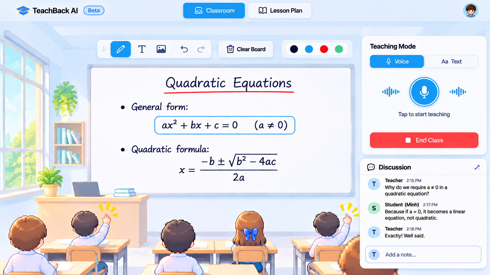

# TeachBack AI

TeachBack AI is a learning-by-teaching classroom simulator. The user explains a subject on an interactive whiteboard while simulated AI students listen and ask questions.

## Classroom Preview



## Workspace

- `ui/` — Next.js frontend
- `app/` — NestJS backend
- `packages/contracts/` — shared API types
- `docs/design/` — approved visual references

## Commands

```sh
npm install
npm run dev       # frontend at http://localhost:3000
npm run dev:api   # backend at http://localhost:4000/api
npm run build
npm test
```

Copy each `.env.example` to `.env.local` or `.env` before enabling MongoDB and Cloudinary. The current foundation runs with mock frontend data and an in-memory backend note repository when external credentials are absent.
